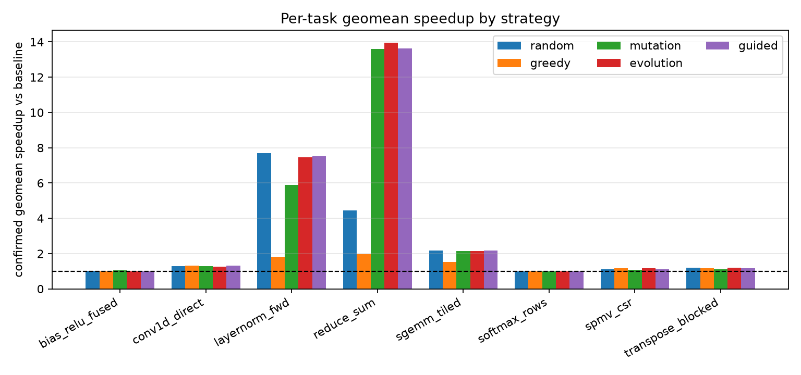
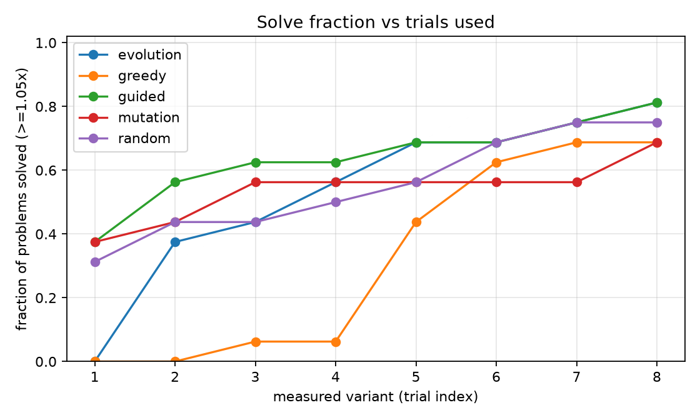
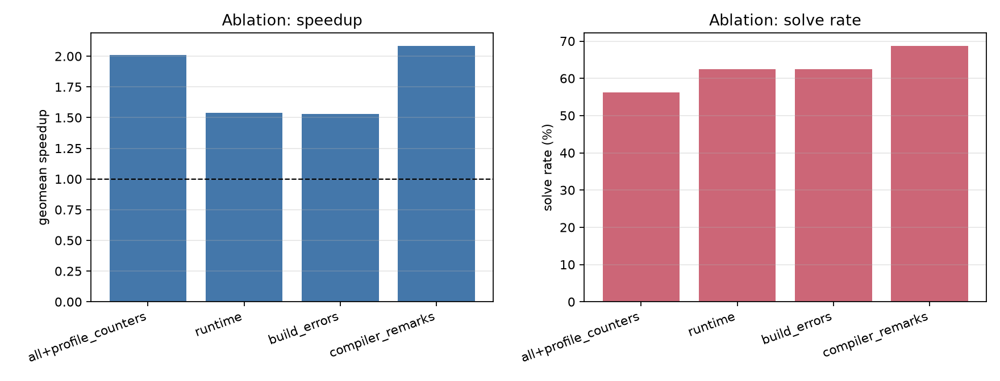
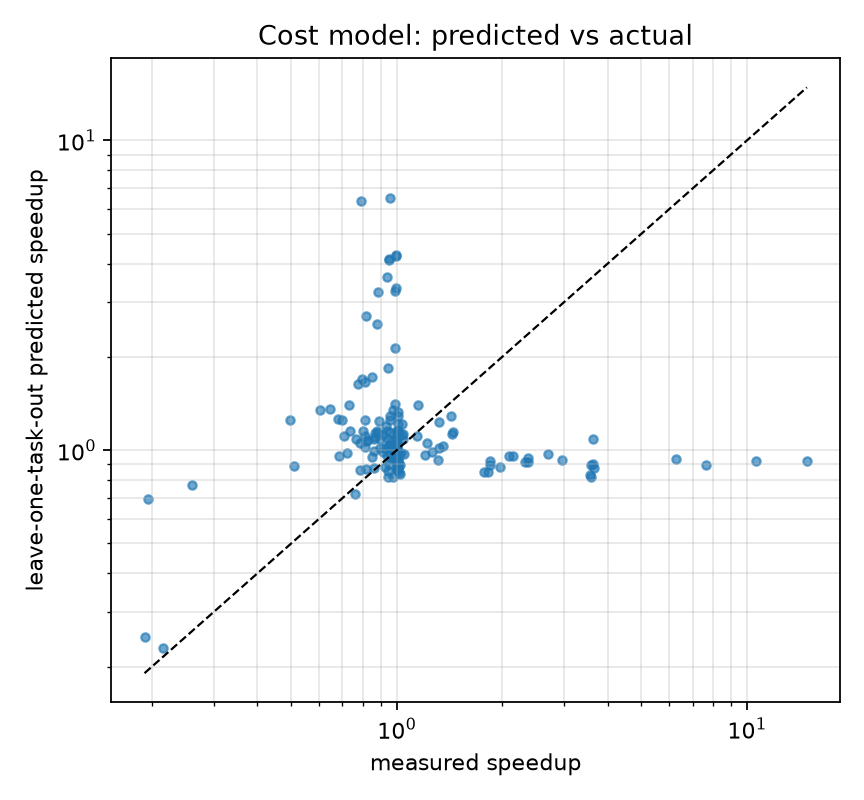

# KernelAgent measured results

Generated 2026-11-05T08:03:51.608009+00:00 from `results/summary.json` at git `714f878`. Every number below is produced by the code in this repository on the machine described next; nothing here is estimated or placeholder.

## Machine and backend

- Machine: macOS-27.2-arm64-arm-64bit on Apple M3
- Cores: 8, memory: 16.0 GiB
- Compiler: clang++ - Apple clang version 21.0.0 (clang-2100.4.1.1)
- Backends present: nvcc=False, ncu=False, triton=False, torch=False, llm_provider=None

## Headline

- Problems: **16** (task, shape) pairs across 8 C++ kernel tasks.
- Measured search trials: **2944**; cache-miss compiles: **402**; compile wall time: **216.3 s**.
- Added exhaustive-oracle variants: **824**; total measured variants including oracle: **3768**.
- Main sweep budget: 8 variants per search, seeds [0, 1, 2]; ablation budget 8, seeds [0, 1].

## Strategy comparison

| Strategy | Solve rate | Geomean | Best task | Worst task | Trials to best | Compiles | Compile s | Wall s | Tokens |
|---|---|---|---|---|---|---|---|---|---|
| random | 75.0% | 1.835 | 7.694 | 1.001 | 3.9 | 130 | 70.5 | 233.2 | 0 |
| greedy | 68.8% | 1.326 | 1.973 | 0.999 | 4.8 | 35 | 19.2 | 124.8 | 0 |
| mutation | 62.5% | 2.020 | 13.606 | 1.000 | 6.5 | 46 | 24.7 | 119.8 | 0 |
| evolution | 68.8% | 2.111 | 13.962 | 0.999 | 5.1 | 113 | 59.7 | 193.8 | 0 |
| guided | 68.8% | 2.096 | 13.634 | 0.987 | 5.4 | 57 | 30.6 | 153.1 | 0 |

Solve rate counts problems whose confirmed best speedup is at least 1.05x. Geomean is over problems with a correct trial; winners were re-measured three times with `confirm_best`. Compile counts are cache misses, so later strategies benefit from variants an earlier strategy already built; treat the compile column as a lower bound on a cold-cache run.

### Per-task geomean speedup

| Task | random | greedy | mutation | evolution | guided |
|---|---|---|---|---|---|
| bias_relu_fused | 1.007 | 1.002 | 1.038 | 0.999 | 1.002 |
| conv1d_direct | 1.289 | 1.311 | 1.290 | 1.271 | 1.309 |
| layernorm_fwd | 7.694 | 1.825 | 5.892 | 7.461 | 7.524 |
| reduce_sum | 4.453 | 1.973 | 13.606 | 13.962 | 13.634 |
| sgemm_tiled | 2.161 | 1.512 | 2.153 | 2.158 | 2.159 |
| softmax_rows | 1.001 | 0.999 | 1.000 | 1.001 | 0.987 |
| spmv_csr | 1.105 | 1.159 | 1.075 | 1.159 | 1.103 |
| transpose_blocked | 1.209 | 1.156 | 1.116 | 1.193 | 1.178 |

### Cost per solved problem

| Strategy | Compile s / solved | Wall s / solved | Tokens / solved |
|---|---|---|---|
| random | 5.88 | 19.43 | - |
| greedy | 1.74 | 11.35 | - |
| mutation | 2.47 | 11.98 | - |
| evolution | 5.43 | 17.62 | - |
| guided | 2.78 | 13.91 | - |

## Feedback-signal ablation

| Feedback signals | Solve rate | Geomean | Trials | Wall s |
|---|---|---|---|---|
| runtime | 62.5% | 1.538 | 256 | 62.0 |
| runtime+build_errors | 62.5% | 1.527 | 256 | 56.3 |
| runtime+build_errors+compiler_remarks | 68.8% | 2.085 | 256 | 53.4 |
| all+runtime+build_errors+compiler_remarks+profile_counters | 56.2% | 2.010 | 256 | 54.8 |

Changes when the next signal is enabled:

- runtime -> runtime+build_errors: solve rate +0.0 pp, geomean -0.011x
- runtime+build_errors -> runtime+build_errors+compiler_remarks: solve rate +6.2 pp, geomean +0.558x
- runtime+build_errors+compiler_remarks -> all+runtime+build_errors+compiler_remarks+profile_counters: solve rate -12.5 pp, geomean -0.075x

## Learned selection

| Model | Spearman | Kendall | Top-1 regret | NDCG@5 | MAE(log) |
|---|---|---|---|---|---|
| cost model | 0.143 | 0.121 | 0.234 | 0.721 | 0.460 |
| pairwise ranker | 0.167 | 0.100 | 0.225 | 0.786 | - |

Leave-one-task-out over 160 measured candidates from 8 tasks; leakage=False.

Compiles-to-best (build requests) with equal budget: random 3.94, model-guided 5.38 (guided saving -36.5%). Cache misses to best: random 1.50, guided 0.50.

Oracle: 14 small-space problems enumerated, mean oracle gap 0.015. Oracle winners are confirmed three times like every other winner; tiny kernels can have large confirmation spread, so gaps of a few percent are within measurement noise.

| Task | Shape | Variants | Oracle speedup | Oracle spread | Best found | Gap |
|---|---|---|---|---|---|---|
| bias_relu_fused | small | 48 | 1.210 | 7.3% | 1.054 | 0.129 |
| bias_relu_fused | large | 48 | 0.963 | 13.4% | 1.030 | 0.000 |
| conv1d_direct | small | 144 | 1.475 | 2.3% | 1.471 | 0.003 |
| conv1d_direct | large | 144 | 1.155 | 1.1% | 1.177 | 0.000 |
| layernorm_fwd | small | 72 | 7.744 | 0.2% | 7.806 | 0.000 |
| layernorm_fwd | large | 72 | 7.124 | 1.3% | 7.599 | 0.000 |
| reduce_sum | small | 48 | 16.726 | 4.0% | 17.085 | 0.000 |
| reduce_sum | large | 48 | 11.584 | 1.3% | 11.523 | 0.005 |
| softmax_rows | small | 32 | 0.999 | 0.1% | 1.002 | 0.000 |
| softmax_rows | large | 32 | 0.997 | 1.2% | 1.003 | 0.000 |
| spmv_csr | small | 36 | 1.159 | 1.2% | 1.168 | 0.000 |
| spmv_csr | large | 36 | 1.144 | 1.7% | 1.154 | 0.000 |
| transpose_blocked | small | 32 | 1.134 | 0.7% | 1.055 | 0.070 |
| transpose_blocked | large | 32 | 1.363 | 0.7% | 1.389 | 0.000 |

## Tool-layer reliability

| Check | Result |
|---|---|
| compile failures (exp01) | 0 / 1920 |
| deliberate syntax error | structured failure |
| repair probes | 3 / 3 runs, 3 repair attempts |
| timeout probes | 3 / 3 timed out, 9 attempts |
| noise MAD/median | p50 0.0084, p90 0.0408, max 0.2419 |
| rerun geomean delta | 1.43% |

## Regressions

- bias_relu_fused / large: 1.030x (best mutation) - no headroom in the legal space: the exhaustive oracle over 48 variants reached only 0.963x (confirmed spread 13.4%)
- bias_relu_fused / small: 1.046x (best mutation) - search miss: the exhaustive oracle over 48 legal variants reached 1.210x, 12.9% above the best found; the budget did not locate it
- softmax_rows / large: 1.001x (best random) - no headroom in the legal space: the exhaustive oracle over 32 variants reached only 0.997x (confirmed spread 1.2%)
- softmax_rows / small: 1.001x (best evolution) - no headroom in the legal space: the exhaustive oracle over 32 variants reached only 0.999x (confirmed spread 0.1%)

Full diagnosis: [`results/regressions.md`](results/regressions.md).

## Backend coverage

- C++17 path: executed for every number above with the compiler named under Machine.
- Triton, CUDA (nvcc) and Nsight Compute (`ncu`): implemented behind `is_available()` and unit-tested with fixtures, but not validated on hardware in this run because this machine has no GPU, nvcc or ncu.
- LLM proposer: LLM proposer implemented and fixture-tested; no API key, so it did not run.

## Provenance

`results/summary.json` embeds the git SHA and environment fingerprint; per-trial evidence is in `results/exp01_strategies_trials.jsonl`, `results/exp02_ablation_trials.jsonl`, `results/rank_dataset.jsonl` and `results/trials.jsonl`.

